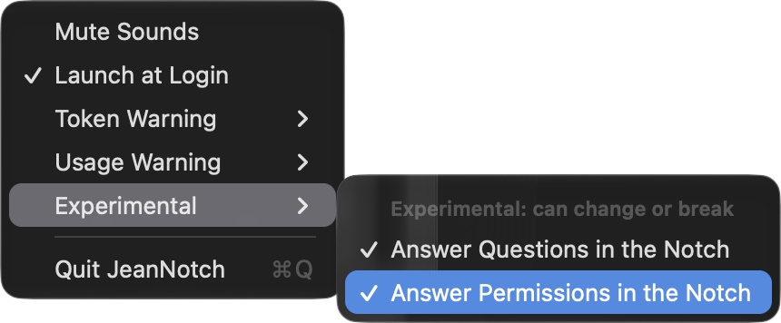
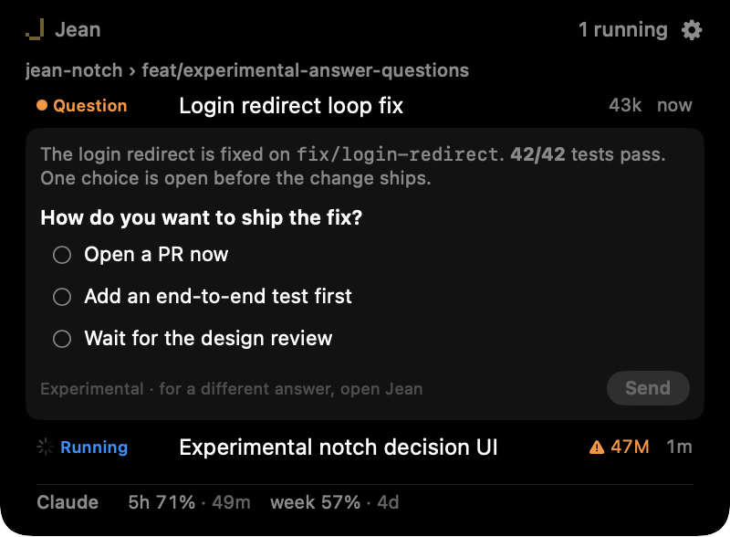
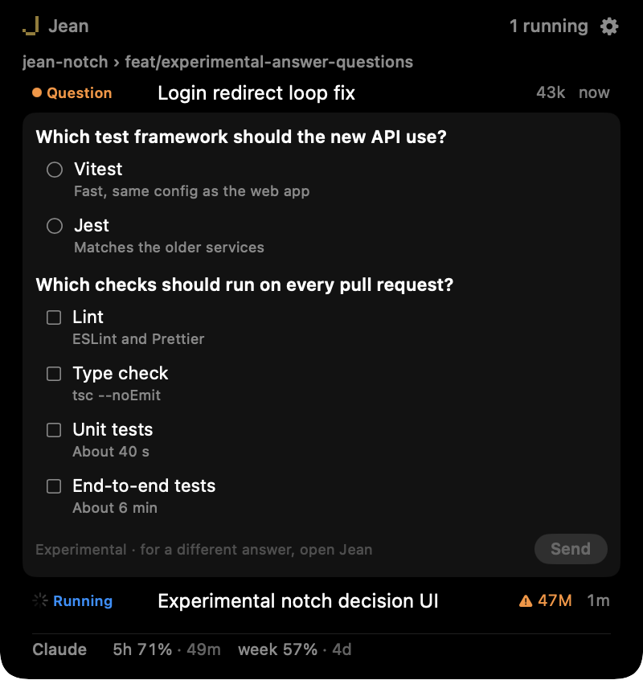
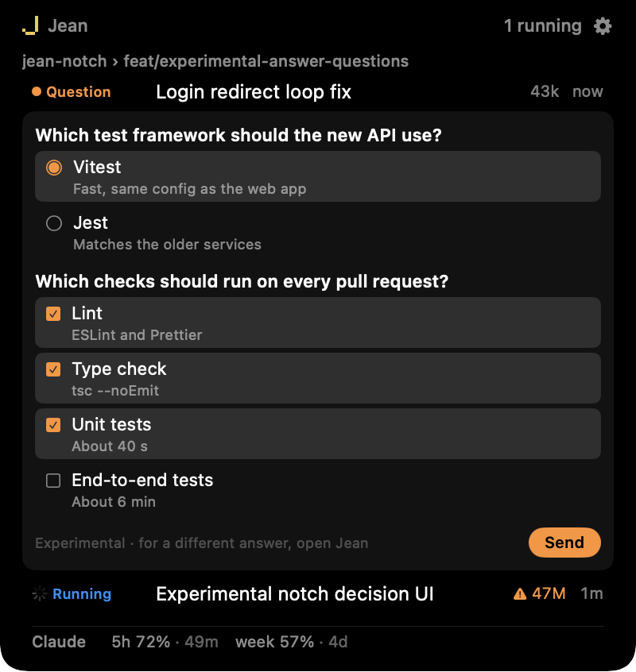

<p align="center"></p>

# JeanNotch

[](https://github.com/NeilujD/jean-notch/actions/workflows/ci.yml)
[](LICENSE)

> **Unofficial.** JeanNotch is a community companion app. It is not affiliated with or endorsed
> by coollabsio or the Jean project.

A small macOS app that sits around the MacBook notch and shows the status of every
running [Jean](https://github.com/coollabsio/jean) session. It is separate from Jean: it only reads
Jean's built-in WebSocket server, unless you turn on an [experimental feature](#experimental-features).

<p align="center">
  <br>
  
</p>

- **Collapsed:** a black shape that blends with the notch. Left: the J and the number of
  running sessions. Right: a dot for the most urgent state (orange = waiting for you,
  red = failed, green = done and unread). A gray bolt means Jean is offline.
- **Expanded** (on hover, and for ~4 s after an alert): sessions grouped by
  project › worktree, sorted waiting → failed → running → done. The notch shows the same
  unread sessions as Jean: a waiting, failed, or done session stays until you open it in Jean
  or click its row. Running sessions always show; idle and read sessions are hidden.
- **PR badge:** a worktree with a pull request shows one badge after its name:
  ✕ CI failing (red), ● Changes requested (orange), ◌ CI running (gray), ✓ Ready (green),
  or ⇡ Merged (purple), with the PR number. A closed PR or no PR shows no badge. The badge
  shows the last PR state Jean knows. Jean checks PRs only while its window is in front:
  every 5 minutes, and faster for the open worktree. "Changes requested" shows only after
  such a check while JeanNotch runs (Jean does not save the review state). A badge change
  plays no sound and does not expand the notch.
- **Tokens:** each row shows the session's total tokens, for example "3.2M"
  (k = thousand, M = million). The total counts input, output, and cache reads and
  writes, summed over all runs. Jean saves a run's usage when the run ends, so the count
  moves when a run finishes. Over the limit, the count turns orange with a ⚠ icon. The
  default limit is 10 million. Change it in the menu (**Token Warning**), or set any value with
  `defaults write build.jean.notch tokenWarning -int 3000000` (0 turns it off).
- **Alert:** when a session starts waiting, finishes, or fails, the notch expands and plays a
  soft system sound (mute it in the menu). Bringing Jean to the front does not mark sessions read.
- **Click a row:** brings Jean to the front and asks it to select that session. This marks the
  session read, in Jean and in the notch.
- **Mark All Read** (menu, with the unread count): marks every unread session read, in the
  notch and in Jean. Jean's unread count goes to 0.
- **Plan usage:** the bottom of the expanded panel shows how much of each plan limit you
  used, for Claude, Codex and Grok, and the time until it resets
  (for example "Claude  5h 1% · 4h55  week 29% · 5d"). A provider you are not logged in to
  is not shown. Jean caches these values for 5 minutes, so they can lag a little. When any
  limit is over 80%, the collapsed notch shows an orange ⚠. Change the limit in the menu
  (**Usage Warning**) or with `defaults write build.jean.notch usageWarning -int 90`
  (0 turns it off). Jean's other agents (OpenCode, Cursor, Pi, and so on) give no usage data.
- **Gear or right-click:** Mute Sounds, Launch at Login, Mark All Read, Token Warning,
  Usage Warning, Experimental, Quit.

### Experimental features

> **Experimental.** These features are off by default. They can change, break, or go away in
> any release. Turn one on in the menu (**Experimental**).

<p align="center">
  
</p>

- **Answer Questions in the Notch.** When a session ends its turn with a question, the
  expanded notch shows a card below the session row: the recap that the assistant wrote, the
  question, and its options. Pick an option, then click **Send**. The session continues with
  your answer.

  <p align="center">
    <br>
    <em>A question asked as text ("Reply with a number:"), with the recap above it.</em>
  </p>
  <p align="center">
    <br>
    <em>A Claude <code>AskUserQuestion</code> call: radio buttons for one answer, check boxes for several.</em>
  </p>
  <p align="center">
    <br>
    <em>Options picked: <strong>Send</strong> turns orange when every question has an answer.</em>
  </p>

  - JeanNotch finds the same questions that Jean shows as buttons: a "Reply with a number:"
    line next to a numbered list of 2 to 8 options, in the last message of the session. Jean's
    prompt asks every agent for this form. A Claude `AskUserQuestion` tool call also gets a
    card, with check boxes for a question that takes several answers. Claude has that tool
    only in Supervised mode, or in Full access mode with Chrome on (Jean then gives Claude a
    permission tool, and the Claude CLI shows the question tool only with one).
  - The session row changes from "Done" to "Question". It stays in the list until the next run
    of the session starts, or until you turn the feature off.
  - The card needs two clicks (pick, then send), because the notch can open under your pointer.
  - JeanNotch sends your answer as a chat message. For a question asked as text, the message is
    the same as the one that Jean's button sends (for example "2. Blue"). Jean starts the next
    run with the model and mode that the session has.
  - JeanNotch sends the same MCP servers as Jean's window: the session's list, else the
    project's, else your default list, plus servers that Jean has not seen before. It also
    sends Jean's Chrome switch. It reads these settings when you click **Send**, so a change
    in Jean applies at once.
  - For an `AskUserQuestion` card, JeanNotch also saves your answer in the session, as Jean's
    own card does, so Jean shows which options you picked. On the first message of a session,
    Jean's automatic naming can probably overwrite that saved answer. The answer is still sent.
  - The notch cannot take keyboard input. To type a different answer, click the session row
    and answer in Jean.
  - JeanNotch finds a question asked as text when a run ends. It does not find one that was
    asked before JeanNotch started. The alert for such a run is still the "done" sound and
    confetti.
  - Plan approvals and Codex or OpenCode question tools have no card yet.
  - While this is on, JeanNotch reads the last run of each session that ends a run
    (`get_session`). When you click **Send**, it also reads the project and preference
    lists and the MCP servers (`list_projects`, `load_preferences`, `get_mcp_servers`), and
    for an `AskUserQuestion` card it saves the answer (`update_session_state`).
    While it is off, JeanNotch sends no message to a session.
  - `defaults write build.jean.notch experimental.answerQuestions -bool true` also turns it on
    (restart JeanNotch after).

- **Stop Sessions from the Notch.** Put the pointer on a running session row: a ■ button
  shows in place of the token count and time. Click it once: it changes to a red **Stop?**.
  Click **Stop?** to stop the run.
  - One click never stops a run, because the notch can open under your pointer. Move the
    pointer off the row and **Stop?** changes back to ■.
  - JeanNotch asks Jean to cancel the run (`cancel_chat_message`). The row then shows the
    state that Jean sends: a stopped run is idle, so the row leaves the list.
  - If Jean cannot stop the run, a short red error shows below the row, and the row stays.
  - While this is off, JeanNotch shows no stop button and stops nothing.
  - `defaults write build.jean.notch experimental.stopSessions -bool true` also turns it on.

- **Answer Permissions in the Notch.** When a Claude session in Supervised mode asks to use a
  tool, the session row shows "Approval" and a card shows below it: the tool name and its input
  (the command for `Bash`; 3 lines, then it scrolls). Click **Deny** to deny at once. Click
  **Allow**, then **Allow?**, to allow. The session then continues.

  - Only Claude in Supervised mode asks during a run. A tool that Claude denies by itself
    shows in Jean at the end of the run: that gets no card. Codex and OpenCode permission
    requests have no card yet.
  - There is no "always allow". To allow a tool for the next runs, open Jean.
  - The card goes away when you answer, when the run continues or ends, or when you answer
    in Jean's window. Jean sends no event for an answer in its window, so the card can stay
    until the run's next tool or the end of the run. If you then click, Jean refuses the
    answer: the card shows the error for a few seconds and goes away.
  - JeanNotch sees only the requests that come while it runs. After a restart of JeanNotch,
    answer an open request in Jean.
  - While this is on, JeanNotch answers with `respond_claude_permission`. While it is off,
    JeanNotch sends no answer.
  - `defaults write build.jean.notch experimental.answerPermissions -bool true` also turns it on
    (restart JeanNotch after).

### The mascot

A flat pixel "J" sits next to the notch. It does not act out urgency (the dot does that):

| State | What it does |
|---|---|
| Sessions running | Pulses softly |
| Nothing running | Stays still |
| Jean offline | Dims |

While the notch is collapsed, the J pulses once every 15 s. It pulses all the time while the
notch is open. This keeps JeanNotch under 1% CPU. A finished session still gets a confetti burst.

The notch opens and closes with a spring. With **Reduce Motion** on (System Settings ›
Accessibility › Display), the J stays still, confetti is off, and the notch only fades.

## Requirements

- macOS 14 or later. A notched MacBook screen is best; other screens get a small pill at the
  top center.
- Swift 6 toolchain (Command Line Tools are enough; Xcode is not needed).
- Jean with its HTTP server enabled.

## Install

Download `JeanNotch-vX.Y.Z.zip` from the [latest release](https://github.com/NeilujD/jean-notch/releases/latest),
unzip it and move `JeanNotch.app` to Applications. The app is ad-hoc signed, not notarized, so
remove the quarantine flag once:

```sh
xattr -dr com.apple.quarantine /Applications/JeanNotch.app
```

## Build and run

```sh
swift build            # debug build
swift test             # reducer and protocol tests
scripts/bundle.sh      # release build → build/JeanNotch.app (ad-hoc signed)
open build/JeanNotch.app
```

If `swift test` fails with `plugin for module 'TestingMacros' not found` or
`no such module 'Testing'`, your Command Line Tools do not give Swift Testing to SwiftPM
(seen with Swift 6.4.2). Then run:

```sh
CLT=/Library/Developer/CommandLineTools
swift test --build-system native \
  -Xswiftc -F$CLT/Library/Developer/Frameworks \
  -Xswiftc -plugin-path -Xswiftc $CLT/usr/lib/swift/host/plugins/testing \
  -Xlinker -rpath -Xlinker $CLT/Library/Developer/Frameworks
```

"Launch at Login" works only from the bundled app. Logs:

```sh
log stream --level debug --predicate 'subsystem == "build.jean.notch"'
```

## Logo

`assets/logo.svg`, `assets/logo.png` and `assets/AppIcon.icns` come from one pixel grid in
`scripts/make-logo.swift`. Edit the grid, then run `swift scripts/make-logo.swift`.
The pixel "J" and its palette are a nod to Jean's logo.

## How it connects

1. At each connection attempt it reads `~/Library/Application Support/com.jean.desktop/preferences.json`
   (`http_server_port`, `http_server_token`, `http_server_bind_host`). A changed port or a
   regenerated token is picked up on the next retry.
2. It connects only to localhost (`ws://127.0.0.1:<port>/ws`) and sends the token in an
   `Authorization: Bearer` header. If Jean binds to another host, JeanNotch refuses to connect.
   The token is never logged.
3. On connect and on `ws:resync`, it loads a snapshot with `list_all_sessions`. After that it
   follows live `chat:*` events. Structure events (`session-renamed`, `worktree:*`,
   `cache:invalidate`) trigger a debounced snapshot reload.
4. It reconnects with exponential backoff (1 s → 30 s) and drops a socket that is silent for 20 s.

## Known limits

- **Jumping to a session is best effort.** JeanNotch calls `set_active_session`, but Jean may
  not switch its visible session yet. A `jean://session/<id>` deep link in Jean is a planned
  follow-up.
- A session waiting on a Claude question or plan is detected from the `AskUserQuestion` /
  `ExitPlanMode` tool event or from the snapshot's `waiting_for_input`.
- The status list shows at most 12 sessions ("+N more" for the rest).

## Releasing

Releases are automated (`.github/workflows/release.yml`, `scripts/release.py`):

1. **PR title** is a Conventional Commit and sets the version bump: `feat:` → New (minor),
   `fix:` → Fix (patch), `perf:` / `refactor:` → Improvement (patch), `!` after the type or a
   `BREAKING CHANGE:` line → Breaking change (major). `docs:`, `ci:`, `chore:`, `test:`,
   `build:`, `style:`, `revert:` stay out of the notes. The `pr-title` check enforces it.
2. **`## Release notes`** in the PR body is the user-facing text (from the PR template). Write
   `none` to leave the PR out; leave it empty to use only the title. A breaking change needs a
   `### Migration` part.
3. PRs are **squash merged**. After each merge to `main`, a bot updates the release PR
   `chore(release): vX.Y.Z` (branch `release/next`): next version, build number in
   `scripts/bundle.sh`, and the full notes. Write an optional intro between its highlights markers.
4. **Merging the release PR** builds `JeanNotch-vX.Y.Z.zip`, tags the commit and publishes the
   GitHub Release. The notes copy this README's **Known limits** section.

Setup: a fine-grained token (this repo only; Contents and Pull requests: read and write) in the
`RELEASE_TOKEN` secret, so CI runs on the release PR. Run `scripts/setup-release-token.sh`: it
walks you through creating the token, checks it and saves the secret. Run it again to renew the
token before it expires.

## License

[Apache License 2.0](LICENSE). Copyright 2026 Julien Collard. See [NOTICE](NOTICE).
