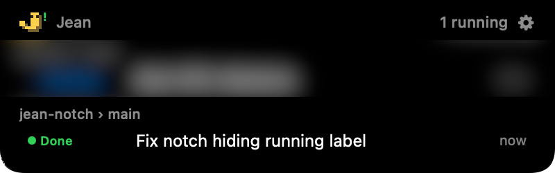

<p align="center"></p>

# JeanNotch

[](https://github.com/NeilujD/jean-notch/actions/workflows/ci.yml)
[](LICENSE)

> **Unofficial.** JeanNotch is a community companion app. It is not affiliated with or endorsed
> by coollabsio or the Jean project.

A small macOS app that sits around the MacBook notch and shows the status of every
running [Jean](https://github.com/coollabsio/jean) session. It is separate from Jean: it only reads
Jean's built-in WebSocket server.

<p align="center">
  <br>
  
</p>

- **Collapsed:** a black shape that blends with the notch. Left: the mascot and the number of
  running sessions. Right: a dot for the most urgent state (orange = waiting for you,
  red = failed, green = done and not seen yet). A gray bolt means Jean is offline.
- **Expanded** (on hover, and for ~4 s after an alert): sessions grouped by
  project › worktree, sorted waiting → failed → running → done. Idle and seen sessions are hidden.
- **Alert:** when a session starts waiting, finishes, or fails, the notch expands and plays a
  soft system sound (mute it in the menu). A finished session stays "unseen" until you click
  its row or bring Jean to the front.
- **Click a row:** brings Jean to the front and asks it to select that session.
- **Gear or right-click:** Mute Sounds, Launch at Login, Quit.

### The mascot

A pixel "J" lives next to the notch and acts out the most urgent state:

| State | What it does |
|---|---|
| Running | Hops along, leaning forward |
| Waiting for you | Taps its foot, with a "?" |
| Done | Jumps for joy, with a "!" (plus a confetti burst when the session finishes) |
| Failed | Falls over with X eyes |
| Jean offline | Sleeps ("z") |

While the notch is collapsed, the mascot holds a pose and fidgets for a few seconds every
15 s. It animates all the time while the notch is open. This keeps JeanNotch under 1% CPU.

The notch opens and closes with a spring. With **Reduce Motion** on (System Settings ›
Accessibility › Display), the mascot stays still, confetti is off, and the notch only fades.

## Requirements

- macOS 14 or later. A notched MacBook screen is best; other screens get a small pill at the
  top center.
- Swift 6 toolchain (Command Line Tools are enough; Xcode is not needed).
- Jean with its HTTP server enabled.

## Build and run

```sh
swift build            # debug build
swift test             # reducer and protocol tests
scripts/bundle.sh      # release build → build/JeanNotch.app (ad-hoc signed)
open build/JeanNotch.app
```

If `swift test` fails with `plugin for module 'TestingMacros' not found` or
`no such module 'Testing'`, your Command Line Tools do not give Swift Testing to SwiftPM
(seen with Swift 6.4.2). Then run:

```sh
CLT=/Library/Developer/CommandLineTools
swift test --build-system native \
  -Xswiftc -F$CLT/Library/Developer/Frameworks \
  -Xswiftc -plugin-path -Xswiftc $CLT/usr/lib/swift/host/plugins/testing \
  -Xlinker -rpath -Xlinker $CLT/Library/Developer/Frameworks
```

"Launch at Login" works only from the bundled app. Logs:

```sh
log stream --level debug --predicate 'subsystem == "build.jean.notch"'
```

## Logo

`assets/logo.svg`, `assets/logo.png` and `assets/AppIcon.icns` come from one pixel grid in
`scripts/make-logo.swift`. Edit the grid, then run `swift scripts/make-logo.swift`.
The pixel "J" and its palette are a nod to Jean's logo.

## How it connects

1. At each connection attempt it reads `~/Library/Application Support/com.jean.desktop/preferences.json`
   (`http_server_port`, `http_server_token`, `http_server_bind_host`). A changed port or a
   regenerated token is picked up on the next retry.
2. It connects only to localhost (`ws://127.0.0.1:<port>/ws`) and sends the token in an
   `Authorization: Bearer` header. If Jean binds to another host, JeanNotch refuses to connect.
   The token is never logged.
3. On connect and on `ws:resync`, it loads a snapshot with `list_all_sessions`. After that it
   follows live `chat:*` events. Structure events (`session-renamed`, `worktree:*`,
   `cache:invalidate`) trigger a debounced snapshot reload.
4. It reconnects with exponential backoff (1 s → 30 s) and drops a socket that is silent for 20 s.

## Known limits

- **Jumping to a session is best effort.** JeanNotch calls `set_active_session`, but Jean may
  not switch its visible session yet. A `jean://session/<id>` deep link in Jean is a planned
  follow-up.
- A session waiting on a Claude question or plan is detected from the `AskUserQuestion` /
  `ExitPlanMode` tool event or from the snapshot's `waiting_for_input`.
- The status list shows at most 12 sessions ("+N more" for the rest).

## License

[Apache License 2.0](LICENSE). Copyright 2026 Julien Collard. See [NOTICE](NOTICE).
